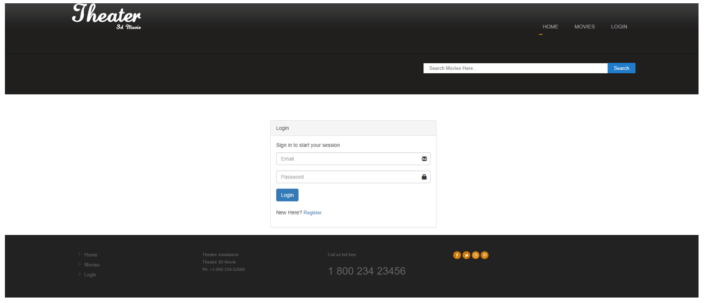
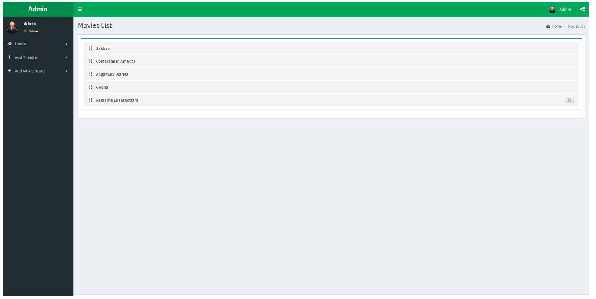

 

  

  # Yashraj CineFlex

  **Online Movie Ticket Booking System**

  A PHP and MySQL web application with cloud hosting and DevOps workflow exposure.

  
  
  
  

---

## About

Yashraj CineFlex is an online movie ticket booking system developed using PHP and MySQL. Users can browse movies, access account features, and book tickets, while administrators can manage movie and show information.

## Key Features

- Movie listings and show details
- User registration and login
- Movie ticket booking
- Movie and show management
- Theatre administration dashboard

## Technology Stack

- **Frontend:** HTML, CSS, JavaScript
- **Backend:** PHP
- **Database:** MySQL
- **Cloud Platform:** Microsoft Azure
- **CI/CD Workflow:** GitHub Actions
- **Version Control:** Git and GitHub

## Cloud Hosting & DevOps

The project explores hosting a PHP web application on Microsoft Azure and using GitHub for source control and workflow management.

**Deployment flow:**

Developer → GitHub Repository → GitHub Actions → Azure App Service → Web Application

This architecture represents the intended deployment flow. Azure hosting and automated deployment should be marked as completed only if the application and workflow have been successfully tested.

## Application Screenshots

### Movie Listing Page

### Login and Registration

### Theatre Admin Dashboard

## Run Locally

1. Install XAMPP or another PHP/MySQL environment.
2. Clone or download this repository.
3. Place the project in the web server directory.
4. Create the database and import the SQL file, if included.
5. Configure the database connection in the PHP files.
6. Start Apache and MySQL.
7. Open the project at its local URL, using the correct folder name.

## Future Improvements

- Improve the CI/CD workflow
- Document database configuration
- Strengthen application security
- Improve cloud deployment and monitoring

## Author

**Yashraj Shitre**

[GitHub Profile](https://github.com/shitreyashraj) · [Project Repository](https://github.com/shitreyashraj/OnlineMovieTicketBS)
