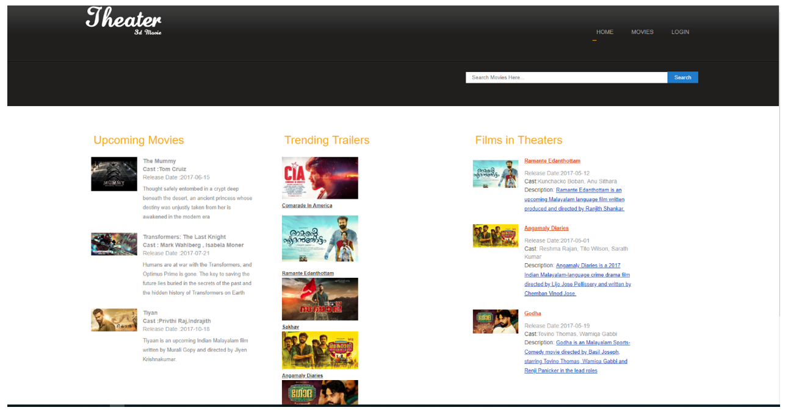

<div align="center">


# Yashraj CineFlex

**Online Movie Ticket Booking System**

A PHP and MySQL web application for browsing movies and managing ticket bookings.


</div>

---

## About

Yashraj CineFlex is a movie ticket booking project built with PHP and MySQL. It is intended to help users browse movies and show information, with administration features for managing movie-related records.

## Features

- Movie listing and show information
- User registration and login
- Movie ticket booking
- Theatre, movie, and show management features
- Admin dashboard

## Technology Stack

- **Frontend:** HTML, CSS, JavaScript (if included in the source)
- **Backend:** PHP
- **Database:** MySQL
- **Version control:** Git and GitHub
- **Workflow:** GitHub Actions configuration (see `.github/workflows`)

## Screenshots

Add screenshots of your actual application to the `screenshots/` folder and update the paths below.

| Movie listing | Login page |
|---|---|
| `screenshots/home-page.png` | `screenshots/login-page.png` |

| Admin dashboard |
|---|
| `screenshots/admin-dashboard.png` |

Once the files are uploaded, replace this note with actual Markdown images, for example:

```markdown

```

## Run Locally

1. Install XAMPP or another PHP/MySQL environment.
2. Download or clone this repository into your web server directory.
3. Create a MySQL database and import the SQL file if one is included.
4. Update the application's database connection settings for your local environment.
5. Start Apache and MySQL.
6. Open the project through `http://localhost/` using the folder name for this project.

Adjust these steps to match the actual source files and database setup in the repository.

## DevOps Learning

This repository can be used to demonstrate Git version control and GitHub workflow configuration. CI/CD and cloud deployment should be described as completed only after the workflow and deployment have been tested successfully.

## Future Improvements

- Validate and improve the GitHub Actions workflow
- Add setup screenshots and database documentation
- Configure secure application settings
- Add verified cloud deployment and health checks

## Author

**Yashraj Shitre**

- [GitHub Profile](https://github.com/shitreyashraj)
- [Project Repository](https://github.com/shitreyashraj/OnlineMovieTicketBS)
